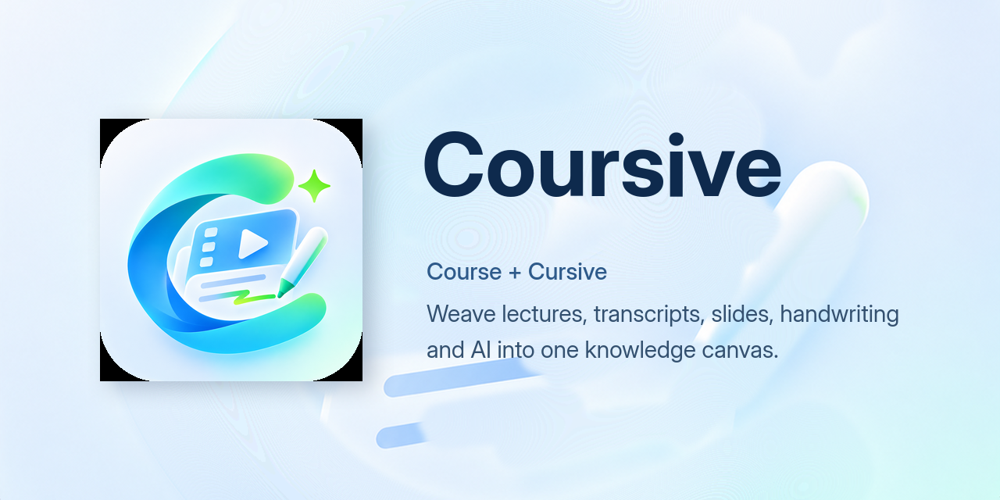

<div align="center">

# Coursive

**Weave lecture video, transcripts, slides, handwriting and AI understanding into one knowledge canvas.**

[](https://github.com/WALKERKILLER/Coursive/actions/workflows/ci.yml)
[](LICENSE)
[](docs/migration.md)
[](#installation)
[](https://github.com/WALKERKILLER/coursive-plugins)



*[简体中文](README.zh-CN.md) · [Documentation](docs/overview.md) · [Plugins](https://github.com/WALKERKILLER/coursive-plugins) · [Contributing](CONTRIBUTING.md) · [Security](SECURITY.md)*

</div>

> [!NOTE]
> Coursive is moving into this repository module by module. The code arrives with its full commit history as each part is refactored; until then this repository holds the governance, documentation, brand assets and design contracts. Follow the plan in [docs/migration.md](docs/migration.md).

## The Little Story Behind the Name

**Coursive** is **Course** + **Cursive**.

Cursive is joined-up handwriting: each letter flows into the next without lifting the pen. Coursive treats a course the same way. A lecture's video, its transcript, the slides on screen, the notes you scribble and what an assistant understands about all of them are not separate files. They are strokes of one continuous line.

The name also points to where that line is drawn: a free-form canvas where you write, sketch and arrange your understanding by hand, and every mark stays connected to the moment in the lecture it came from.

## What is Coursive?

Coursive is a local-first study workspace for recorded lectures. It keeps your courses on your own device, turns them into searchable, linked material, and gives you a canvas and an assistant to think with.

- **Local-first library**: import lecture videos and courseware into folders you own. A rebuildable index makes everything searchable; nothing requires an account.
- **Transcripts you can trust**: cloud or fully local speech recognition, aligned to the video, with review suggestions you accept or reject.
- **Slides and frames**: courseware is parsed into searchable text, and key frames are sampled from the video so the screen at any moment is one click away.
- **Study canvas**: an infinite canvas for handwriting, stylus ink, cards and source excerpts; every card links back to its timestamp, slide or note.
- **An assistant that cites its sources**: course-aware conversations, outlines, notes and practice quizzes, with every action recorded and undoable and an approval mode you control.
- **Plugins**: views, tools, skills and content sources come from plugins installed through a marketplace with mirror-aware downloads ([design](docs/specs/draft-plugin-marketplace.md)).
- **Your data, your sync**: export to Markdown tools, back up, or sync course folders across devices through storage you choose.
- **Everywhere you study**: Linux, Windows, macOS and Android from one Flutter codebase.

## Plugins and Sign-in

Coursive has no built-in account and no built-in sign-in. It starts straight into your local library.

Anything that talks to an external course platform is a **source plugin**. Install one from the marketplace and its sign-in page, course list and downloads appear; uninstall it and they disappear, while everything already in your library stays. Credentials a source plugin needs are sealed by the local daemon and never leave your device. The contract is in [docs/specs/draft-source-provider-plugins.md](docs/specs/draft-source-provider-plugins.md).

The plugin index, the download mirror list and the official plugins live in [coursive-plugins](https://github.com/WALKERKILLER/coursive-plugins). Coursive measures the available GitHub mirrors and picks the fastest one automatically; every download is checked against the signed index, so a mirror can make a download faster but never change what you install.

## Installation

Pre-release packages will be published on [Releases](https://github.com/WALKERKILLER/Coursive/releases) once the app code has moved here. Each release will carry:

- **Linux**: AppImage, deb, rpm, Arch package and tarball for x64 and arm64.
- **Windows**: installer and portable zip.
- **macOS**: dmg and zip.
- **Android**: one APK per ABI (arm64-v8a, x86_64).

Building from source is described in [docs/development.md](docs/development.md).

## Repository Layout

```text
Coursive/
├── .agents/skills/     # review, decision and governance workflows for contributors and agents
├── .github/            # CI, issue and pull request templates
├── .repo-seed/         # governance manifest
├── assets/brand/       # logo master and every exported icon (see assets/brand/README.md)
├── docs/
│   ├── decisions/      # architecture and process decisions (MADR)
│   ├── postmortems/    # incident write-ups linked to guardrails
│   └── specs/          # change contracts, Draft → Approved → Implemented
└── scripts/            # governance gates and the brand export script
```

The app (`app/`, Flutter), the local daemon (Go) and the assistant host (`agent/`, Node.js) join this tree as they migrate; [docs/architecture.md](docs/architecture.md) describes how they fit together.

## Contributing

Read [CONTRIBUTING.md](CONTRIBUTING.md) and [AGENTS.md](AGENTS.md) first; human and AI contributors follow the same rules. Run the governance gates before every commit:

```sh
node scripts/run-gates.mjs
```

Plugin authors start in [coursive-plugins](https://github.com/WALKERKILLER/coursive-plugins).

## Feedback and Security

- **Bugs and ideas**: open an [issue](https://github.com/WALKERKILLER/Coursive/issues/new/choose).
- **Vulnerabilities**: report privately as described in [SECURITY.md](SECURITY.md); please do not open a public issue.

## License

Coursive is released under the [MIT License](LICENSE).

---

<div align="center">

[↑ Back to top](#coursive)

</div>
