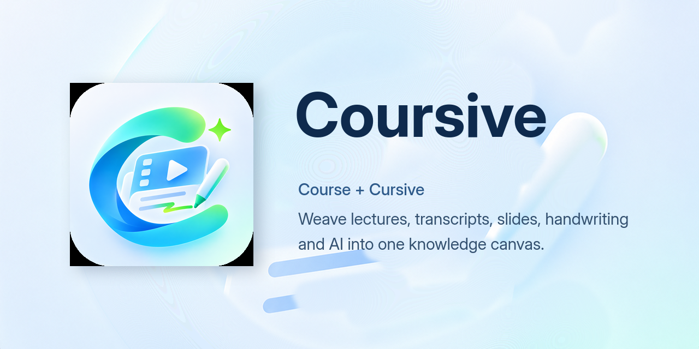

<div align="center">

# Coursive

**把课程视频、字幕、课件、手写笔记和 AI 的理解，编织成一张知识画布。**

[](https://github.com/WALKERKILLER/Coursive/actions/workflows/ci.yml)
[](LICENSE)
[](docs/migration.md)
[](#安装)
[](https://github.com/WALKERKILLER/coursive-plugins)



*[English](README.md) · [文档](docs/overview.md) · [插件](https://github.com/WALKERKILLER/coursive-plugins) · [参与贡献](CONTRIBUTING.md) · [安全](SECURITY.md)*

</div>

> [!NOTE]
> Coursive 正在逐个模块迁入本仓库。每个部分重构完成后，代码会连同完整的提交历史一起迁入。在此之前，本仓库只包含治理规则、文档、品牌素材和设计契约。迁移计划见 [docs/migration.md](docs/migration.md)。

## 名字的由来

**Coursive** 由 **Course**（课程）和 **Cursive**（连笔书写）组合而成。

连笔字一气呵成，笔尖不离纸面，每个字母都连着下一个字母。Coursive 用同样的方式看待一门课：视频、字幕、屏幕上的课件、你随手写下的笔记，以及助手对它们的理解，不是互不相干的文件，而是同一条连续的笔画。

这个名字也指向书写发生的地方：一张自由的画布。你在上面手写、勾画、整理自己的理解，每一笔都连回它在课程中出现的那一刻。

## Coursive 是什么

Coursive 是一个面向录播课程的本地优先学习工作台。课程保存在你自己的设备上，变成可搜索、相互链接的资料，并配有一张画布和一位助手，帮助你思考。

- **本地优先的课程库**：把课程视频和课件导入你自己的文件夹。可重建的索引让所有内容都能搜索，不需要任何账号。
- **可信的字幕**：支持云端或完全本地的语音识别，字幕与视频对齐。校对建议由你决定采纳或忽略。
- **课件与画面**：课件被解析为可搜索的文本，视频按关键帧采样，任何时刻的屏幕内容一点即达。
- **学习画布**：一张无限画布，承载手写、触控笔笔迹、卡片和资料摘录。每张卡片都连回对应的时间点、课件页或笔记。
- **会引用出处的助手**：了解课程内容的对话、大纲、笔记和练习题。每项操作都有记录、可以撤销，审批方式由你决定。
- **插件**：视图、工具、技能和内容来源都由插件提供，通过插件市场安装，下载会自动选择镜像（[设计](docs/specs/draft-plugin-marketplace.md)）。
- **数据由你掌握**：可以导出到 Markdown 工具、备份，或通过你选择的存储在多台设备间同步课程文件夹。
- **随处学习**：Linux、Windows、macOS 和 Android 共用一套 Flutter 代码。

## 插件与登录

Coursive 没有内置账号，也没有内置登录。启动后直接进入本地课程库。

所有连接外部课程平台的功能都由**来源插件**提供。从插件市场安装后，它的登录页、课程列表和下载功能才会出现；卸载后这些功能随之消失，已经存入课程库的内容保持不变。来源插件需要的凭据由本机守护进程加密保存，不会离开你的设备。契约见 [docs/specs/draft-source-provider-plugins.md](docs/specs/draft-source-provider-plugins.md)。

插件索引、下载镜像列表和官方插件维护在 [coursive-plugins](https://github.com/WALKERKILLER/coursive-plugins) 仓库。Coursive 会测量可用 GitHub 镜像的速度，自动选择最快的一个。每次下载都会对照签名索引校验，镜像只能让下载变快，无法改变你安装的内容。

## 安装

应用代码迁入后，预发布安装包会发布在 [Releases](https://github.com/WALKERKILLER/Coursive/releases) 页面。每个版本包括：

- **Linux**：AppImage、deb、rpm、Arch 软件包和 tar 包，支持 x64 和 arm64。
- **Windows**：安装程序和免安装 zip 包。
- **macOS**：dmg 和 zip 包。
- **Android**：每种 ABI 一个 APK（arm64-v8a、x86_64）。

从源码构建的方法见 [docs/development.md](docs/development.md)。

## 仓库结构

```text
Coursive/
├── .agents/skills/     # 供贡献者和智能体使用的审查、决策与治理流程
├── .github/            # CI、Issue 模板和 Pull Request 模板
├── .repo-seed/         # 治理清单
├── assets/brand/       # Logo 原图和全部导出图标（见 assets/brand/README.md）
├── docs/
│   ├── decisions/      # 架构与流程决策（MADR）
│   ├── postmortems/    # 事故复盘，每篇都连到防护措施
│   └── specs/          # 变更契约，Draft → Approved → Implemented
└── scripts/            # 治理检查和品牌素材导出脚本
```

应用（`app/`，Flutter）、本机守护进程（Go）和助手宿主（`agent/`，Node.js）会在迁移过程中陆续加入。三者的关系见 [docs/architecture.md](docs/architecture.md)。

## 参与贡献

请先阅读 [CONTRIBUTING.md](CONTRIBUTING.md) 和 [AGENTS.md](AGENTS.md)，人类贡献者和 AI 遵循同一套规则。每次提交前运行治理检查：

```sh
node scripts/run-gates.mjs
```

插件作者请从 [coursive-plugins](https://github.com/WALKERKILLER/coursive-plugins) 开始。

## 反馈与安全

- **问题与建议**：提交 [Issue](https://github.com/WALKERKILLER/Coursive/issues/new/choose)。
- **安全漏洞**：请按 [SECURITY.md](SECURITY.md) 私下报告，不要公开提交 Issue。

## 许可证

Coursive 以 [MIT 许可证](LICENSE)发布。

---

<div align="center">

[↑ 回到顶部](#coursive)

</div>
